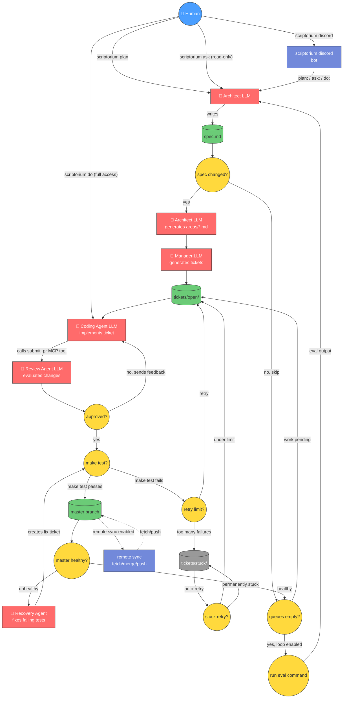

# scriptorium

Git-native agent orchestration for software projects.

Scriptorium keeps planning and execution state in Git, runs a strict Architect → Manager → Coding → Review workflow, and merges work only when `master` stays green.

> **Note:** Scriptorium is experimental. There is no warranty. Letting agents run loose is a bad idea but this is still a fun project. You should probably run this in a container.



**Legend:** 🔴 Red = LLM agent, 🟡 Yellow = code decision, 🟢 Green = git state, 🔵 Blue = human, 🟣 Purple = Discord bot

## Usage

Use `scriptorium plan` to talk to the **Architect** — the planning agent that reads your project source and maintains `spec.md`. The Architect decides what work needs to be done and breaks it into areas and tickets. `scriptorium plan` opens an interactive session where you can describe what you want built or changed, and the Architect updates the spec accordingly.

Use `scriptorium ask` for an interactive read-only conversation with the Architect. It has the same context as `plan` but won't modify the spec — useful for asking about the codebase, checking status, or getting the Architect's perspective on a design question.

Use `scriptorium do` for ad-hoc tasks that need full repo access — running tests, pushing to remotes, fixing one-off issues, or any work that doesn't belong in the spec. The Architect operates directly in the repo root with no write guards.

Use `scriptorium import` after initialization to reconcile `spec.md` with the project as it currently exists. Import reads the repository but writes only `spec.md`; it does not create tickets, edit source code, or start workers. Explicitly planned future work remains in the spec and stays distinguished from implemented behavior.

Once your spec is ready, run `scriptorium run` in a terminal (or in tmux) to start the main orchestration loop. It watches the spec, generates tickets, assigns coding agents, reviews their work, and merges passing changes into `master`.

```bash
# Tell the Architect what to build
scriptorium plan

# Ask a read-only question
scriptorium ask

# Run an ad-hoc task with full repo access
scriptorium do "run make test and report the results"

# Once the spec is ready, start the orchestration loop (eg. in tmux)
scriptorium run
```

### Importing an existing project

If you already have a project and want scriptorium to manage it, run
`scriptorium init` followed by `scriptorium import` in the repo root:

```bash
scriptorium init
scriptorium import
```

The Architect reads the source, tests, configuration, README, and relevant
documentation, then reconciles `spec.md` with the project as it exists. Import
preserves clearly marked future plans and may be run again as the repository
evolves. From there, use `scriptorium plan` for new goals and `scriptorium run`
to begin implementation.

Path and workflow terminology is defined in `docs/terms.md`.

## Status

Current features:
- CLI commands: `init`, `import`, `run`, `status`, `plan`, `ask`, `do`, `quest`, `audit`, `dashboard`, `discord`, `mattermost`, `sync`, `worktrees`, `--version`, `--help`
- Architect → Manager → Coding → Review agent workflow
- `do` mode for ad-hoc tasks with full repo access (no ticket pipeline)
- Parallel coding agents with area-based conflict avoidance
- Ticket dependencies (`**Depends:**` field — tickets with unsatisfied deps are skipped)
- Transcript-byte budget tracking across concurrent agent roles
- Stuck ticket parking after repeated failures, with automatic retry recovery
- Recovery agent: when master tests fail, the Architect creates and executes a fix ticket automatically
- Remote sync: automatic fetch/merge/push to configured git remotes
- Configurable timeouts, retry limits, and concurrency
- Merge safety with test gates and merge queue
- Loop system for feedback-driven iterative development (eval → architect → work → repeat)
- Web dashboard for monitoring spec, tickets, agents, and logs
- Discord bot integration with mode prefixes (`ask:`, `plan:`, `do:`)
- One ACPort runtime for Codex, Claude, Grok, and custom ACP profiles
- Native multi-turn conversations, explicit session resume, and interrupted coding recovery

## Core workflow

At a high level:

1. Engineer describes goals via `scriptorium plan`. The Architect LLM writes and revises `spec.md`.
2. Orchestrator reads `spec.md` and generates `areas/*.md` (Architect).
3. Orchestrator generates `tickets/open/*.md` from areas (Manager).
4. Open tickets are assigned to `.scriptorium/worktrees/tickets/<ticket>/` worktrees and moved to `tickets/in-progress/`. Multiple tickets are assigned concurrently when they touch independent areas.
   - Tickets with unsatisfied `**Depends:**` references are skipped until their dependencies reach `done/`.
5. Coding agent implements the ticket and calls its ticket-scoped `submit_pr` MCP tool, with a nonempty summary.
6. Review agent evaluates the changes — approves or requests changes. Rejected work resumes the assignment conversation when supported, with review feedback.
7. Merge queue processes one item at a time:
   - merge `master` into ticket branch
   - run `make test` and `make integration-test` in ticket worktree
   - on pass: fast-forward merge to `master`, move ticket to `tickets/done/`
   - on fail: move ticket back to `tickets/open/` and append failure notes
   - on repeated failures: park ticket in `tickets/stuck/`
8. When the loop system is enabled and all queues drain, a feedback command runs and the Architect updates the spec to start the next iteration.

If `spec.md` is missing or still the placeholder, the loop idles and logs:
`WAITING: no spec — run 'scriptorium plan' or 'scriptorium import'`

## Quick start

### 1) Prerequisites

- Nim >= 2.2.14, Nimby >= 0.2.3, Git, and `make`
- Node.js >= 22 (Node 24 in Docker/CI), OpenSSL and libcurl development/runtime libraries
- Agent authentication: Codex OAuth or `OPENAI_API_KEY` / `CODEX_API_KEY`; Claude OAuth or `ANTHROPIC_API_KEY`; Grok login or `XAI_API_KEY`
- Docker Compose is an alternative to the host toolchain. AWS Bedrock is unsupported.

### 2) Build

```bash
make setup agent-setup build
export PATH="$PWD/.build/agent-tools/node_modules/.bin:$PATH"
./scriptorium --version
```

`make setup` installs exact `nimby.lock` revisions into `.build/nimby`, verifies
their commits, and generates `nim.cfg`. It does not change global Nimby packages.
`make agent-setup` installs the locked CLIs and official ACP adapters under
`.build/agent-tools`, without replacing global installations. Add the resulting
`node_modules/.bin` directory to PATH when using Scriptorium in another project.
Use `nix develop` for system libraries on NixOS; the compiler must still meet the
minimum version.

### 3) Initialize a repo

From your project root:

```bash
scriptorium init
```

This creates the orphan branch `scriptorium/plan` with base planning structure.

### 4) Configure agents (optional but recommended)

Create `scriptorium.json` in repo root:

```json
{
  "agents": {
    "architect": { "acpAgent": "codex" },
    "coding":    { "acpAgent": "claude" },
    "manager":   { "acpAgent": "codex" },
    "reviewer":  { "acpAgent": "codex" },
    "audit":     { "acpAgent": "claude" }
  },
  "endpoints": {
    "local": "http://127.0.0.1:8097"
  },
  "concurrency": {
    "maxAgents": 4,
    "outputBudgetMB": 100
  },
  "timeouts": {
    "codingAgentHardTimeoutMs": 14400000,
    "codingAgentNoOutputTimeoutMs": 300000,
    "codingAgentProgressTimeoutMs": 600000,
    "codingAgentMaxAttempts": 5
  },
  "loop": {
    "enabled": false,
    "feedback": "bash scripts/eval.sh",
    "goal": "Improve eval score",
    "maxIterations": 0,
    "feedbackTimeoutMs": 7200000
  },
  "dashboard": {
    "host": "127.0.0.1",
    "port": 8098
  },
  "discord": {
    "serverId": "",
    "channelId": "",
    "allowedUserIds": [],
    "allowedUsers": []
  },
  "logLevel": "INFO",
  "fileLogLevel": "DEBUG"
}
```

Notes:
- Each role selects a named `acpAgent` profile: `codex`, `claude`, or `grok`. The default is Claude.
- Omitted/empty `model` uses the agent default. Explicit `model`, `reasoningEffort`, and `configOptions` values must be advertised by the agent; unsupported selections fail clearly.
- `concurrency.maxAgents` is the shared manager/coder slot pool (default 4).
- `concurrency.outputBudgetMB` caps cumulative structured transcript bytes before pausing new assignments (default 0 = unlimited). This measures output volume, not tokens or cost. Deprecated `tokenBudgetMB` is accepted when the canonical field is absent.
- Timeout defaults: 4h hard timeout, 5min no-output timeout, 10min progress timeout, 5 max attempts.
- `endpoints.local` defaults to `http://127.0.0.1:8097` when omitted.
- `logLevel` / `fileLogLevel` can be overridden via `SCRIPTORIUM_LOG_LEVEL` / `SCRIPTORIUM_FILE_LOG_LEVEL` environment variables.

### ACP profiles and migration

Execution uses [ACPort](https://github.com/monofuel/ACPort), with
[`codex-acp`](https://github.com/zed-industries/codex-acp),
[`claude-agent-acp`](https://github.com/zed-industries/claude-agent-acp), and Grok's
native `agent --no-leader stdio` interface. These adapters are the official ACP
integration; no additional editor plugin is required.

Custom ACP agents can be configured without a Scriptorium harness:

```json
{
  "acpAgents": {
    "local": {
      "command": "/path/to/my-acp-agent",
      "args": ["--stdio"],
      "env": {"MY_SETTING": "value"},
      "readOnlyMode": "read-only",
      "writeMode": "agent"
    }
  },
  "agents": {"coding": {"acpAgent": "local"}}
}
```

Profiles also support `modelOption` / `effortOption` identifiers for agents
without standard configuration categories, `authMethod` for headless ACP auth,
and `readOnlyArgs` for agents that need enforceable launch restrictions.
Permission decisions are per action. Read-only operations reject mutating and
ambiguous permissions; agents must also expose a restricted mode or explicitly
configured launch restrictions. Grok uses tool-deny launch arguments because it
does not advertise ACP modes. Planning retains its file write guards.

Existing `codex`, `claude-code`, and `grok-build` harness settings translate to
ACP profiles on load without rewriting the file. Explicit `acpAgent` wins.
Typoi and Hermes execution was removed; migrate those roles to an ACP profile.
Old explicit model identifiers remain explicit and must be supported by the
selected agent. Clear stale identifiers to use its default model.

### 5) Build the spec

```bash
scriptorium plan
scriptorium plan "Add CI checks for merge queue invariants"
```

The Architect reads source from the repository and writes `spec.md` and optional
`tickets/open/` entries in `.scriptorium/worktrees/plan`. Other writes fail the
command. Interactive `/show`, `/help`, and `/quit` commands remain available.
Each interactive conversation uses one native ACP session rather than embedding
previous replies into every prompt.

Resume a stored conversation with `scriptorium plan --resume <session-id>`,
`scriptorium ask --resume <session-id>`, or `scriptorium do --resume <session-id>`.
The operation, directory, agent settings, and access policy must match. Agents
that cannot load sessions start an explicitly reported fresh recovery session.
Coding assignments recover matching interrupted sessions automatically, with a
new scoped MCP connection. Durable completion receipts prevent lost submissions
between the MCP response and merge-queue enqueueing.

### 6) Run and monitor

```bash
scriptorium run
scriptorium status
scriptorium worktrees
scriptorium dashboard
```

Default-branch health and merge gates both run `make test` and
`make integration-test`. The Architect and review/merge run sequentially;
managers and coders share the configured slot pool. Remote sync is disabled by
default and can be enabled in `remoteSync`.

`scriptorium run` writes human-readable logs to
`.scriptorium/logs/orchestrator/run_<UTC timestamp>.log`. Agent artifacts include
structured ACP JSONL, a separate stderr diagnostic log, the last assistant
message, and typed completion/failure details. Heartbeats and stderr chatter do
not count as agent progress. Output budgets measure protocol events received
during turns across all roles. Private session records and submission receipts
live in managed runtime state, without credentials or scoped MCP URLs.

Ctrl+C cancels interactive turns. Prompt watchdogs cancel cooperatively and
close stalled connections after a five-second grace period. Orchestrator
SIGINT/SIGTERM stops scheduling, waits for workers, and shuts down HTTP cleanly.

### 7) Optional integrations

The feedback loop runs an evaluation command after work drains and asks the
Architect to revise the spec. Configure `loop.enabled`, `feedback`, `goal`,
`maxIterations` (0 means unlimited), and `feedbackTimeoutMs`.

`scriptorium discord` and `scriptorium mattermost` use ACP for `plan:`, `ask:`,
and `do:` messages. Configure the server/channel and allowed users, plus
`DISCORD_TOKEN` or `MATTERMOST_TOKEN`. These commands send messages to the
configured service. `scriptorium sync` runs an explicitly configured remote
sync cycle. The existing automatic audit trigger and `audit` CLI remain disabled
pending separate stabilization; the audit agent itself uses the shared ACP
runtime.

## CLI reference

```text
scriptorium init [path]       Initialize the planning branch
scriptorium import            Reconcile spec with the current repository
scriptorium plan [prompt]     Interactive planning or one-shot spec update
scriptorium ask               Interactive read-only conversation
scriptorium do [prompt]       Interactive or one-shot task with full repo access
scriptorium plan|ask|do --resume <session-id>
scriptorium run               Start orchestrator
scriptorium quest <prompt>    Run until the quest is satisfied
scriptorium status            Show tickets and agents
scriptorium worktrees         List ticket worktrees
scriptorium dashboard         Start the web dashboard
scriptorium discord           Start Discord bot
scriptorium mattermost        Start Mattermost bot
scriptorium sync              Run remote synchronization
scriptorium --version
scriptorium --help
```

## Plan branch layout

`scriptorium/plan` stores `spec.md`, `areas/`, tickets in `open/`, `in-progress/`,
`done/`, and `stuck/`, plus `decisions/`, `queue/merge/`, and `health/cache.json`.
Tickets exist in one state directory. Journaled Git transitions recover
interrupted moves and queue changes.

## Testing and CI

```bash
make test                         # Offline unit tests, bounded parallel jobs
make test-arc test-orc             # ACP lifecycle under both memory managers
make integration-test             # Real git/HTTP and all three ACP backends
make integration-test-codex        # One real ACP backend (also claude / grok)
make e2e-test                      # Real spec-to-merge workflow for each backend
make e2e-test-grok                 # One full workflow (also codex / claude)
```

Live tests require the pinned tools and authentication for their named backend.
The combined targets require all three. Missing credentials, provider errors,
and shutdown failures fail tests; there are no environment-based skips.
Mocked runners and the independent protocol peer belong in unit tests. Live ACP
coverage includes streaming, settings, permissions, MCP tool completion,
native turns, restore with a fresh MCP endpoint, cancellation/reuse, concurrent
isolation, and shutdown. Results are retained under `.build/test-results` and
`.build/live`. Run each suite once per relevant change, rerunning failures after
fixing their cause.

Build/PR CI runs offline tests and packages the binary. Trusted master/manual
integration and E2E workflows install the pinned CLIs/adapters and require
`OPENAI_API_KEY`, `ANTHROPIC_API_KEY`, and `XAI_API_KEY` repository secrets.

```bash
make docker-build                  # Build locally; does not publish
# Or: docker compose up --build
```

Docker bundles the pinned compiler, CLI tools, adapters and dependencies. Compose
mounts the repository and existing Codex, Claude, and Grok credential directories.
Rebuild after changing Scriptorium or its tool/dependency locks. See
[the v20 migration record](docs/v20.md) and [version runbook](docs/version-runbook.md).

## License

MIT. See `LICENSE`.
